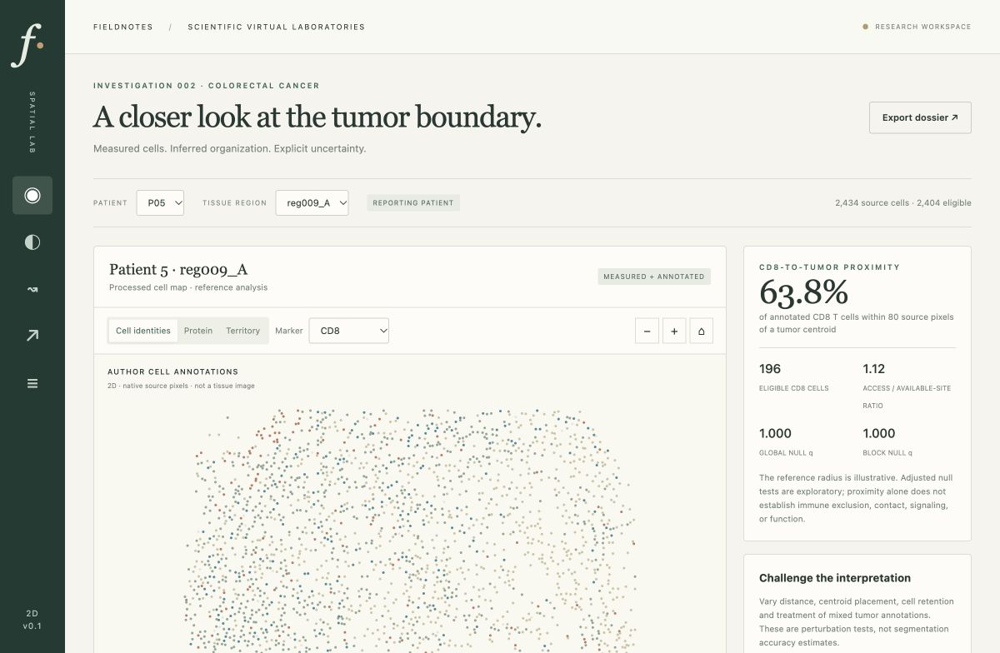

# Fieldnotes · Spatial tumor laboratory

An interactive, measured 2D colorectal cancer investigation: inspect cells, quantify CD8-to-tumor proximity, challenge assumptions, recover a deliberately masked protein channel, and explore hypothetical movement.

This repository contains the completed first local release, its audited reduced input, and the retained investigation. Later scientific and product updates can build on this version.



## Run locally

Use Python **3.12 or newer**. The recorded environment was Python 3.13.15 on macOS ARM64 with the exact versions in `requirements.txt`.

```sh
git clone https://github.com/hiddenlif/spatial-tumor-lab.git
cd spatial-tumor-lab
python3 -m pip install -r requirements.txt
python3 -m spatial_lab.server --port 8841
```

Open **http://127.0.0.1:8841**. On macOS, `run.command` starts the same application once dependencies are installed. Stop with Ctrl+C. The local server uses loopback only; no external model service or credentials are needed. The development preview is stopped after verification. Interactive records persist in the ignored `.runtime/` directory.

## A useful first investigation

1. Open the tissue atlas and inspect source cells, protein channels and inferred territory. Patient and region selectors cover all 35 patients and 140 regions.
2. Select **P35 → reg070_A → Reconstruction**. Choose **Contiguous x-band 30%**, seed **101**, and marker ridge regression.
3. Run reconstruction. The retained failure case has an intensity RMSE of about **2.044 log units**, yet shifts marker-high proximity from **71.4% to 92.3%**. Reveal the held-out measurements to see why channel accuracy and downstream fidelity must be evaluated separately.
4. Compare a spatial interpolation or median baseline. Record an interpretation with its uncertainty.
5. Run sensitivity checks or a conditional movement scenario. Export the region dossier and source-cell CSV.

Reconstructed cells have amber rings. The truth toggle is explicitly for validation. Author cell identities are inferred annotations; processed fluorescence values are measured-derived signals. Tumor-rich territory and generated marker values are project inferences. Movement is simulated, in pixels per step.

## Executed results

- **258,385** source cells; **240,554** eligible after explicit annotation exclusions.
- **140** reference regions across **35** patients; **123** have sufficient tumor and CD8 cells for the primary proximity estimand.
- **504** reconstruction comparisons on seven reporting patients, kept separate from 21 training and seven development patients.
- **90** conditional movement runs. These do not predict migration or treatment response.
- **19** scientific, HTTP and source-binding tests passed. A fresh run reproduced eight substantive study artifacts exactly.

Marker regression reduced channel reconstruction error, but downstream proximity error did not improve consistently. No region met the adjusted depletion threshold under the planned null tests; limited randomization resolution and the cohort's sampling prevent interpreting this as absence of exclusion.

Read the [investigation and failures](docs/INVESTIGATION.md), [methods](docs/METHODS.md), [source audit](docs/SOURCE_AUDIT.md), and [verification record](docs/VERIFICATION.md).

## Reproduce

```sh
python3 -m unittest discover -s tests -v
python3 scripts/verify_results.py
python3 scripts/reproduce.py --out reports/my-reproduction
```

Use a new output directory. Originals are preserved. See [reproducibility](docs/REPRODUCIBILITY.md).

## Python code quality

```sh
python3 -m pip install -r requirements-dev.txt
ruff check .
ruff format --check .
```

Ruff is pinned to 0.17.2 and configured for Python 3.12+. The [cleanup verification](reports/ruff-cleanup-v1/README.md) records tests, source provenance and scientific replay results.

## Data and scope

The source is [Schürch's Mendeley Data V1 deposit](https://data.mendeley.com/datasets/mpjzbtfgfr/1), DOI **10.17632/mpjzbtfgfr.1**, licensed CC BY 4.0. The full 223 MB original CSV is retained locally and ignored for future Git. A 21 MB selected-column representation is included under `data/derived/`, with source hash, units, joins and attribution. See [data attribution](DATA_ATTRIBUTION.md).

This release analyzes processed 2D centroids. It does not rerun image segmentation, establish a registered tumor boundary, reconstruct patient-specific 3D tissue, or predict clinical outcomes. Ridge regression is the fitted model; the application has no autonomous LLM connection.

See the [public-release review](reports/public-release-review/README.md) for current checks. The source dataset's CC BY 4.0 licence is separate from the project code; no project-code licence has been assigned.
